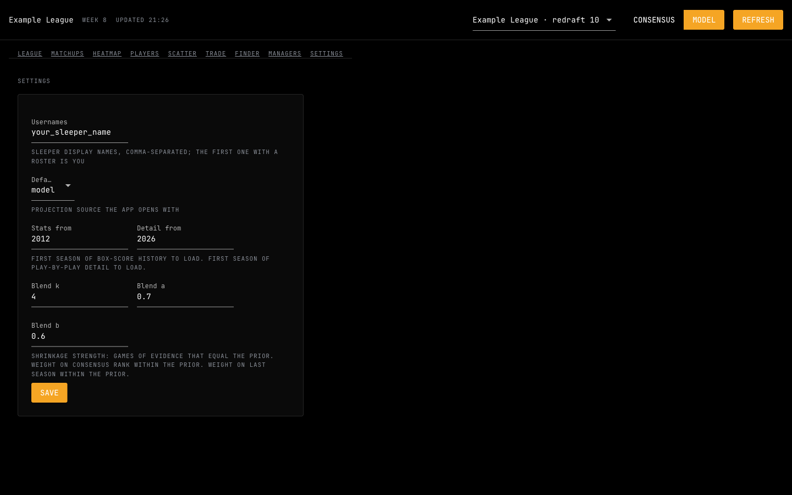
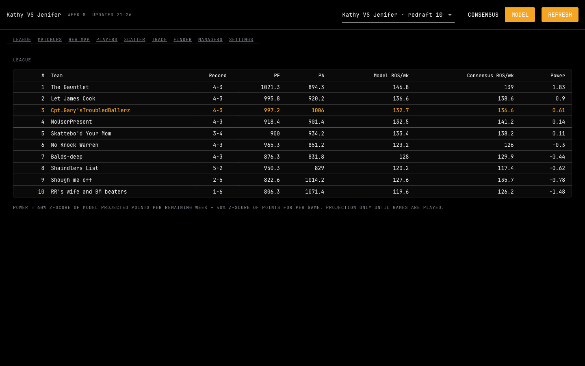
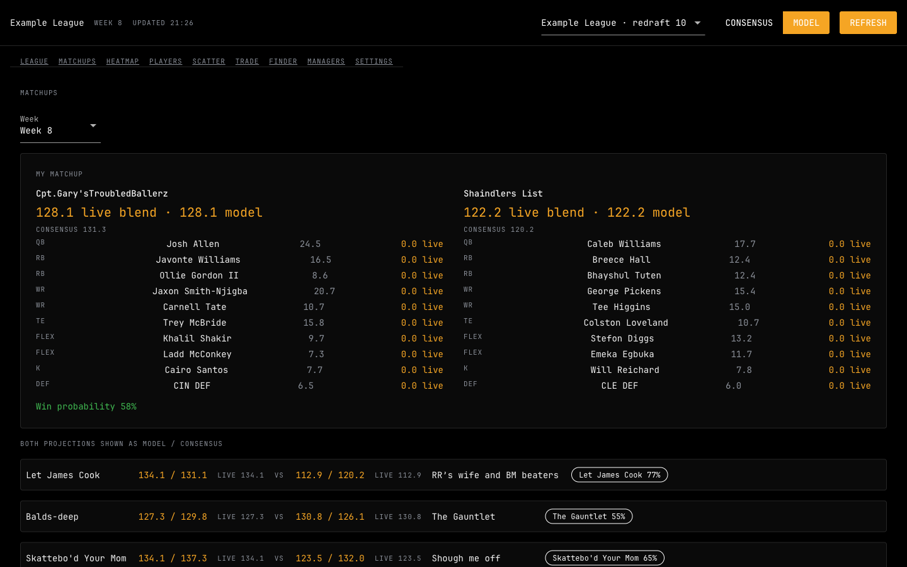
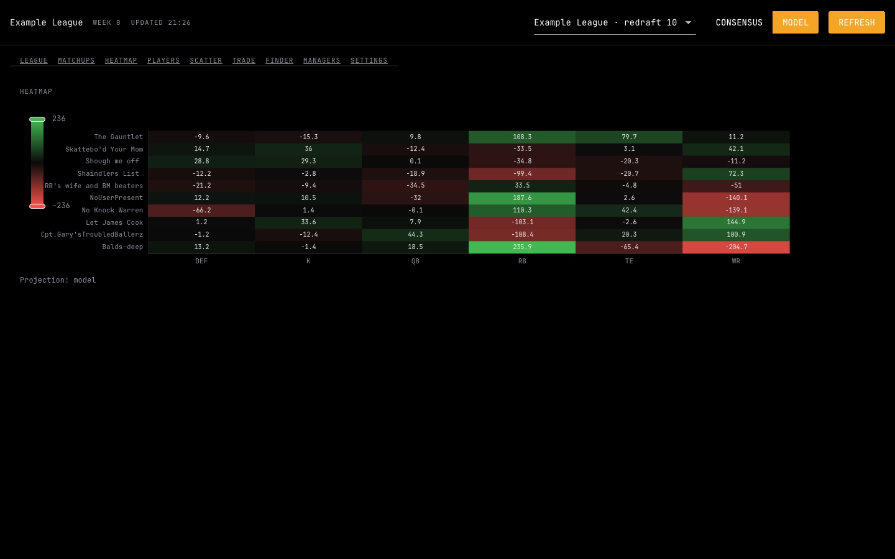
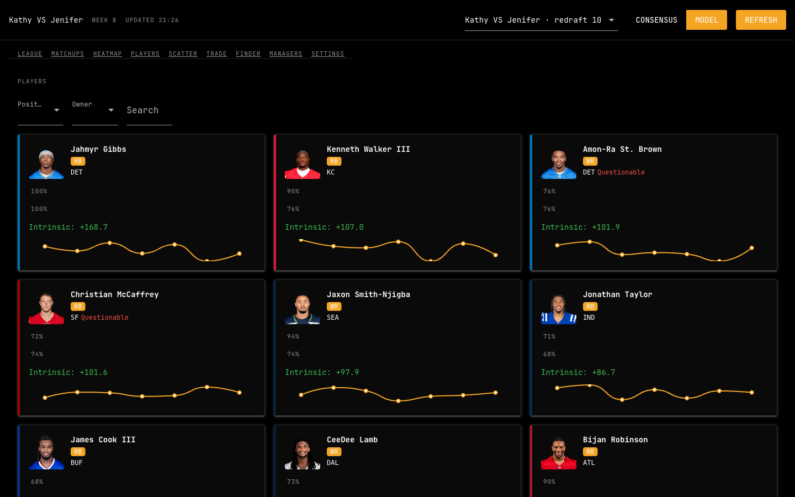
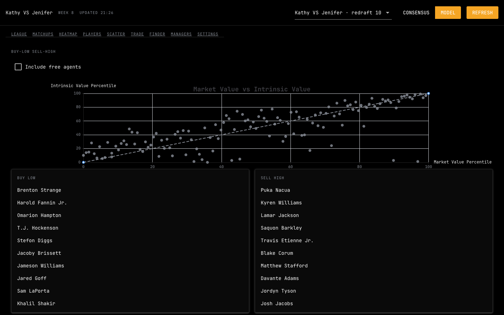
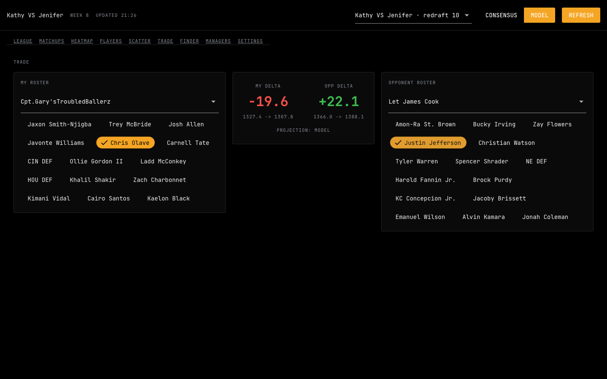
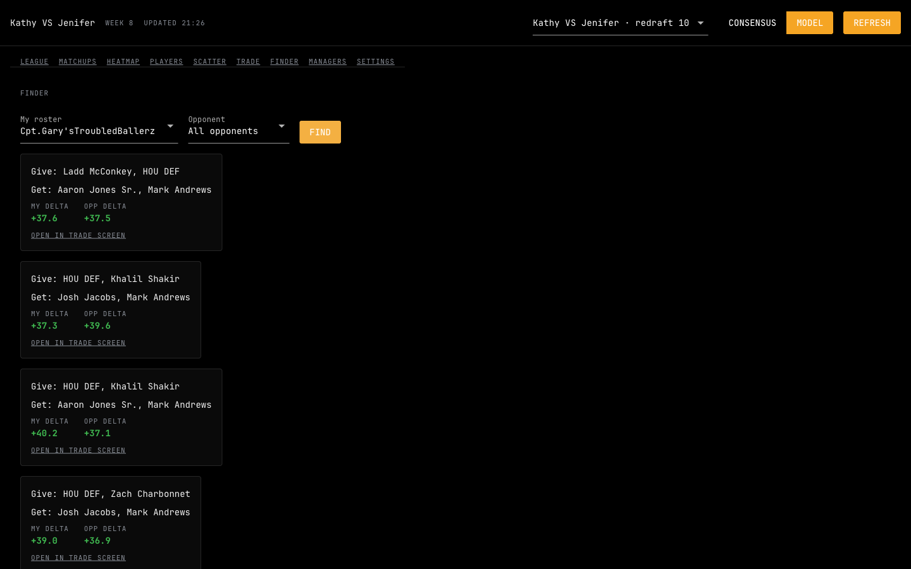

# FF Analyst

My friend's roster decisions warranted an investigation. The investigation now has a dashboard. And if I get paid one more season to have friends play fantasy football with me. I'll have enough money to take all their mothers out on a date.

FF Analyst brings fantasy football league data, projections, and market information together to compare teams, evaluate players, and make roster decisions. The group chat now has supporting evidence.

## What it shows

- League standings with records, points for, and points against
- Model and consensus rest-of-season projections
- Team power rankings
- Views for matchups, players, trades, and more

The model is being tested against past seasons before its rankings get treated as reliable. Sorting a table does not grant prophetic authority.

## Getting started (no coding needed)

This app runs on your own computer. Your league data is downloaded from Sleeper and stored in a folder next to the app. Nothing is uploaded anywhere. You need a Sleeper account and an internet connection.

### 1. Download the app (one time)

1. On this GitHub page, click the green **Code** button, then **Download ZIP**.
2. Open your Downloads folder and unzip the file (double click it on Mac, right click and **Extract All** on Windows).
3. Move the unzipped folder somewhere easy to find, like your Documents folder.

### 2. Start the app

Open the unzipped folder and double click the start file for your computer:

- **Mac:** `Start FF Analyst.command`. The first time, your Mac may say it cannot be opened because it is from an unidentified developer. Right click the file, choose **Open**, then click **Open** again. You only have to do this once.
- **Windows:** `Start FF Analyst.bat`. The first time, Windows may show a blue "protected your PC" box. Click **More info**, then **Run anyway**.

A small black window appears and the app opens after it. The first time, it installs a free helper called `uv` and everything the app needs, which takes a few minutes. After that it starts in seconds.

To start the app again later, double click the same file. To quit, close the app window and the small black window.

### 3. Connect your league

1. Click **SETTINGS** in the menu at the top.
2. Type your Sleeper username in the **Usernames** box. If you are in several leagues with friends, you can add their usernames too, separated by commas.
3. Click **SAVE**.



The app now finds your leagues and downloads the history it needs. This took about one minute in testing, and a bit longer on a slow connection. When it finishes, click **LEAGUE** in the menu to see your league. If you are in more than one league, pick the one you want from the drop down at the top right.

The app checks for new data on its own when you open it. Click **REFRESH** at any time to pull the latest scores, injuries and rosters.

### A tour of the screens

Use the menu across the top to move between screens. The **MODEL** and **CONSENSUS** buttons at the top right switch between this app's own projections and expert consensus projections.

**League** shows every team's record, points for and against, projected points per week for the rest of the season, and a power ranking. Your team is highlighted in orange.



**Matchups** shows this week's games. For each one you see both lineups, each player's projection, and each team's chance of winning.



**Heatmap** shows where each team is strong or weak by position. Green means a team is stronger than the rest of the league at that position, red means weaker. A red square on your team next to a green square on another team is a natural trade.



**Players** lists players with their projected value to you and a small chart of their expected weekly points. Use the filters at the top to narrow by position or owner, or type a name into the search box.



**Scatter** compares what the market thinks a player is worth against what the model thinks. Players the model likes more than the market are listed under **Buy Low**. Players the market likes more than the model are under **Sell High**.



**Trade** lets you test a trade. Pick your team on the left and another team on the right, then click the players that would change hands. The middle shows how much each side gains or loses in projected points. Green is a gain and red is a loss.



**Finder** looks for trades for you. Pick your team, pick one opponent or all of them, and click **FIND**. It lists trades that help both sides, and each one has a link that opens it on the Trade screen. The search can take a few seconds.



**Managers** shows how each person in your league has behaved: how often they trade, who they trade with, and whether they tend to overpay.

### If something goes wrong

- **"another ff-analyst instance is already running"**: the app is already open somewhere else. Close the other window, then click **RETRY**.
- **"no league selected"**: go to **SETTINGS**, enter your Sleeper username and click **SAVE**.
- **The numbers look old**: click **REFRESH** at the top right.
- **The start file will not open, or you prefer typing commands**: open Terminal (Mac) or PowerShell (Windows), type `cd ` and drag the app folder into the window, press Enter, then run `uv run python -m app run`. If `uv` is not found, install it first with the line for your system from https://docs.astral.sh/uv/getting-started/installation/.
- **No app window opens, or it opens blank**: use your web browser instead. On Mac, run `FF_NATIVE=0 uv run python -m app run`. On Windows PowerShell, run `$env:FF_NATIVE=0; uv run python -m app run`. Then open `http://127.0.0.1:8765` in your browser.
- **Anything else**: close the window, run the start command again, and open an issue on this GitHub page with a description or screenshot of what you saw.

The screenshots above are from one example league. Your screens will show your own league, teams and players.

## Project status

An active personal project. The interface, data pipeline, model, and backtests are still being developed.

Rankings and projections are estimates. The confidence required to send a trade offer remains your responsibility.

## Development

Built with Python. The repository contains:

| Directory | Contents |
| --- | --- |
| `app/` | Application code |
| `tests/` | Automated tests |
| `docs/` | Design notes and the reasoning behind the decisions |

Run the tests from the repository root:

```bash
uv sync
uv run pytest -q
```

## Settings and tuning

Eventually, you will be able to disagree with the model directly in Settings. A formal complaints department, with sliders.

**Planned:** once the tuning work ships, model settings will be editable here. League configuration supplied by Sleeper, including lineup slots, scoring rules, and team count, stays tied to the league.

Those controls are planned, not a description of a finished tuning interface.

## How the model works

### Points per game: the preseason opinion gradually loses authority

The model blends a starting estimate with current-season performance:

```text
PPG = (k × prior + n × data) / (k + n)
```

- **prior:** the starting points-per-game estimate before this season’s games are played
- **data:** the player’s observed points per game this season
- **n:** games played this season
- **k:** how much weight the prior gets, expressed in games; default `4`

The prior starts with expert consensus rank converted to points, blended with last season’s points, then multiplied by an age adjustment.

Before any games are played, the prior carries the estimate. As the season progresses, actual performance gets more influence. With `k = 4` and `n = 12`, current-season data gets 75% of the weight and the prior gets 25%.

The preseason opinion is allowed to speak. It is not allowed to chair the meeting indefinitely.

### Age adjustment: the prior has been informed about aging

For each position and age, the app looks at historical changes in scoring from one year to the next. It takes the median of those next-year/current-year ratios to build an age multiplier.

For example, a multiplier of `0.92` for a 31-year-old running back reduces that player’s prior by 8%.

- The multiplier is capped between `0.7` and `1.1`.
- It is a lookup table, not a separate player score.
- It adjusts the prior only.

The calendar gets a vote. It does not get to rewrite the player’s current-season production.

### Opponent factor: this week’s defense has entered the discussion

The matchup factor compares points allowed to the player’s position with the league average:

```text
opponent factor = defense’s points allowed to the position / league average
weekly projection = PPG × opponent factor
```

A factor above `1.0` indicates a softer matchup. A factor below `1.0` indicates a tougher one.

Early in the season, the ratio is pulled toward `1.0` using a shrinkage weight of six games. The factor is also capped between `0.9` and `1.1`.

One strange Sunday is not permitted to become an entire defensive philosophy.

### Availability: the player does need to participate

Injury and roster statuses map to fixed multipliers. Examples:

| Status | This week | Rest of season |
| --- | --- | --- |
| Out | `0` | `0.85` |
| Doubtful | `0.25` | — |
| Questionable | `0.85` | — |

The dash means no rest-of-season value is specified here. Rest-of-season penalties are generally milder than weekly penalties. Bye weeks and IR are assigned zero under the availability rules.

These are model assumptions. “Questionable” has not been solved as a concept.

### Value over replacement: compared with whom, exactly?

A player scoring 12 points a week matters a lot more when the alternative scores six than when the alternative also scores 12.

The app estimates replacement level at each position using the league’s starting slots and team count: the projected score of the best player outside the group required to fill those starting positions.

```text
intrinsic value = projected rest-of-season points − replacement points
```

This measures projected points above that league-specific replacement baseline. It is a starting-slot baseline, not a guarantee that the replacement player is sitting unclaimed on waivers.

“He’s good” has been asked to provide a reference point.

### Best lineup: FLEX required a disproportionate response

Several features depend on the same question: given these players and these starting slots, which valid lineup has the highest projected score?

- Fixed-position slots use the highest projected scorers eligible for those positions.
- FLEX slots require considering players from multiple eligible positions.
- Dynamic programming tracks the best result for each partial choice instead of repeatedly solving the same combinations.
- Before that search, the candidate pool is trimmed to players who could fill the relevant flex slots.

The goal is the highest-scoring valid lineup under the model’s projections and slot constraints. That is different from knowing who will actually score the most on Sunday.

```text
team strength = sum of best-lineup projected points over every remaining week
```

I wanted to compare teams. The bench now requires an optimization procedure.

### Win probability: being favored is not a legally binding agreement

A team projected for 110 points is favored over one projected for 100. The model turns that gap into a win probability:

```text
P(win) = Φ(gap / (σ × √2))
```

- **gap:** your projected score minus your opponent’s
- **σ:** the assumed standard deviation of one team’s scoring error around its projection
- **√2:** combines the errors of two teams, assuming independent errors with the same standard deviation
- **Φ:** the standard normal cumulative distribution function, which converts the scaled gap into a probability

A gap of zero gives a 50% chance. A larger σ means more uncertainty, so the same projected lead produces a less confident forecast.

As games progress, the model reduces uncertainty based on the share of starters still to play, so a completed matchup reads as decided.

#### Current calibration: confidence has been called in for questioning

The current code uses `σ = 20`.

The available 2022–2026 backtest results reported a typical team-score miss of about 26 points and showed that `20` was overconfident: when the model said roughly 74%, that side won about 61% of the time.

The appropriate σ is still being tuned. The planned Settings controls will allow it to be changed.

The model has been informed that confidence is not a substitute for being right.

## Backtesting: the model must bring receipts

The app replays seasons week by week, projecting with only the information available at that point, then compares the predictions with what actually happened.

No borrowing next month’s information to make last month’s predictions look intelligent.

### Ranking accuracy

One evaluation metric is Spearman rank correlation: rank players by projected points, rank them again by actual points, and compare the orderings.

For rankings without ties, the formula is:

```text
ρ = 1 − 6Σd² / [n(n² − 1)]
```

- **n:** number of players being ranked
- **d:** one player’s projected rank minus their actual rank
- **d²:** squares each difference, so positive and negative misses cannot cancel; a four-rank miss contributes 16, while a one-rank miss contributes one
- **Σd²:** the sum of all squared rank differences
- **n(n² − 1):** part of the normalization that makes results comparable across ranking sizes

The result ranges from `−1` to `+1`:

| Value | Meaning |
| --- | --- |
| `+1` | The rankings agree perfectly |
| Near `0` | Little monotonic association between the rankings |
| `−1` | The rankings are perfectly reversed |

For a completely reversed ranking, the squared differences sum to `n(n² − 1) / 3`. The factor of six makes that worst case subtract two from one, giving `−1`.

If players share ranks, Spearman correlation needs tie-aware handling, typically correlation of the average ranks, rather than blindly applying the shortcut above.

Rank correlation measures ordering. Probability calibration is a separate question, which is why the win-probability checks matter too.

A convincing leaderboard still has to survive contact with the schedule.

## Dedication

For everyone who keeps losing to the same person before the playoffs and has requested an independent investigation.

And for the guys who announce they’re taking it seriously this year, then abandon the operation in Week 4.

The group chat has been entered into evidence. <3

